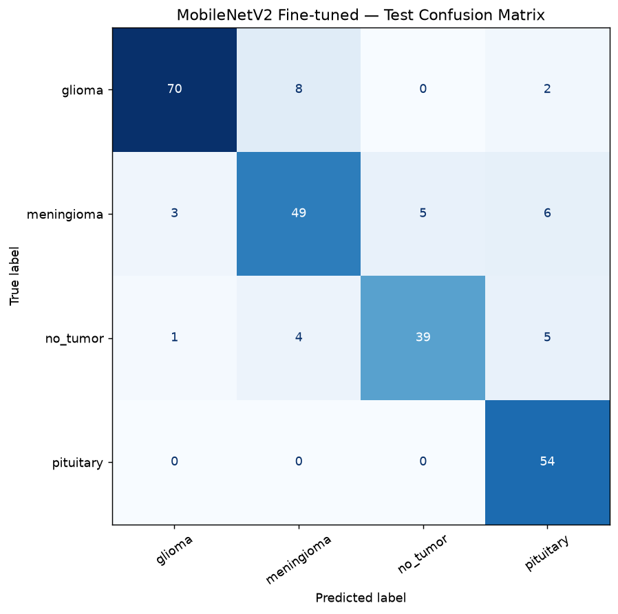

<div align="center">

# BrainTumor AI

### Brain MRI Classification · Model Evaluation · Interactive Streamlit Dashboard

An educational deep-learning project that explores four-class brain MRI image classification with **MobileNetV2**, TensorFlow/Keras, and Streamlit.

[Overview](#overview) · [Dashboard](#interactive-dashboard) · [Results](#evaluation-snapshot) · [Setup](#getting-started) · [Limitations](#limitations-and-responsible-use)

</div>

---

> **Research and education only.** This experimental classifier is not clinically validated and is not a medical device. It must not be used to diagnose or rule out a condition, or to guide treatment. MRI scans should be interpreted by a qualified medical professional.

## Project dashboard

| **4 classes** | **2,443 images** | **86.18% test accuracy** | **MobileNetV2** |
|:---:|:---:|:---:|:---:|
| Glioma · Meningioma · No Tumor · Pituitary | Train 1,695 · Validation 502 · Test 246 | Held-out test set · 246 images | Fine-tuned transfer learning |

## Overview

BrainTumor AI is a learning-focused project for building and inspecting an image-classification workflow. It includes dataset exploration, preprocessing, a custom CNN baseline, MobileNetV2 transfer-learning experiments, evaluation artifacts, and an interactive dashboard for reviewing model outputs.

The Streamlit app can display saved evaluation metrics and dataset summaries, and lets a user upload an image to inspect the model's predicted **dataset class** and its four output scores. A score is a model output, not a diagnosis or a calibrated measure of certainty.

### Classification labels

| Label | Description |
|---|---|
| Glioma | Dataset class label |
| Meningioma | Dataset class label |
| No Tumor | Dataset class label |
| Pituitary | Dataset class label |

## Interactive dashboard

The app includes these sections:

- **Overview:** headline metrics, evaluation chart, and dataset summary.
- **Dataset Explorer:** class counts by train, validation, and test split.
- **MRI Analysis:** upload and preview a JPG, PNG, BMP, or WEBP image, then view the predicted class and class-score distribution.
- **Model Insights:** recorded test metrics and the confusion matrix, when the report files are available.
- **About:** model configuration and project workflow.

The app expects the trained checkpoint at `models/mobilenetv2_finetuned_best.keras`. Model files are excluded from Git by the repository's `.gitignore`; add a checkpoint from your own training run before using inference.

## Evaluation snapshot

The figures below come from the saved final evaluation report in `reports/final_test_results.json`.

| Metric | Recorded result |
|---|---:|
| Test accuracy | **86.18%** |
| Macro F1-score | **85.77%** |
| Macro recall | **86.22%** |
| Test images | **246** |

These are results from one held-out split of this dataset. They do not establish clinical performance or indicate how the model will work on images from other hospitals, scanners, or patient populations.

### Test confusion matrix



## Dataset

Place the dataset in the following folder layout. The MRI images are not distributed with this repository; obtain them under their original license and terms.

```text
dataset/
├── train/
│   ├── glioma/
│   ├── meningioma/
│   ├── no_tumor/
│   └── pituitary/
├── valid/
│   ├── glioma/
│   ├── meningioma/
│   ├── no_tumor/
│   └── pituitary/
└── test/
    ├── glioma/
    ├── meningioma/
    ├── no_tumor/
    └── pituitary/
```

### Image counts

| Split | Glioma | Meningioma | No Tumor | Pituitary | Total |
|---|---:|---:|---:|---:|---:|
| Train | 564 | 358 | 335 | 438 | **1,695** |
| Validation | 161 | 124 | 99 | 118 | **502** |
| Test | 80 | 63 | 49 | 54 | **246** |
| **Total** | **805** | **545** | **483** | **610** | **2,443** |

The app resizes uploaded RGB images to **160 × 160** pixels for inference. Training and evaluation preprocessing should remain consistent with the notebooks and saved model.

## Getting started

### Requirements

- Python 3.10 or a compatible version supported by the installed TensorFlow release
- pip
- The MRI dataset for notebook workflows
- A trained model checkpoint for app inference

The exact dependency list is in [`requirements.txt`](requirements.txt).

### 1. Create an environment

```powershell
python -m venv .venv
.\.venv\Scripts\Activate.ps1
python -m pip install --upgrade pip
pip install -r requirements.txt
```

On macOS/Linux, activate the environment with `source .venv/bin/activate`.

### 2. Prepare local data and model

- Arrange MRI images under `dataset/train`, `dataset/valid`, and `dataset/test`, with one folder per class.
- Place your trained checkpoint at `models/mobilenetv2_finetuned_best.keras`.
- The dataset and model weights are intentionally ignored by Git; they are not included in a fresh clone.

### 3. Launch the dashboard

Run from the repository root:

```powershell
python -m streamlit run app/streamlit_app.py
```

Open the local address printed by Streamlit, typically `http://localhost:8501`.

## Training and evaluation workflow

The notebooks cover the project lifecycle:

1. `01_Dataset_Analysis.ipynb` — inspect the dataset and class distribution.
2. `02_Data_Preprocessing.ipynb` — prepare image data and labels.
3. `03_Custom_CNN_Training.ipynb` — train a custom CNN baseline.
4. `04_Transfer_Learning.ipynb` — run MobileNetV2 transfer-learning experiments.
5. `05_Model_Evaluation.ipynb` — evaluate and report model performance.

Evaluation outputs and plots are stored in `reports/`. The test split should be reserved for final reporting; model selection and tuning should use the training and validation data.

## Repository layout

```text
Brain-Tumor-AI/
├── app/
│   └── streamlit_app.py
├── dataset/                 # local data; excluded from Git
├── models/                  # local checkpoints; excluded from Git
├── notebooks/
│   ├── 01_Dataset_Analysis.ipynb
│   ├── 02_Data_Preprocessing.ipynb
│   ├── 03_Custom_CNN_Training.ipynb
│   ├── 04_Transfer_Learning.ipynb
│   └── 05_Model_Evaluation.ipynb
├── reports/                 # summaries, metrics, and figures
├── requirements.txt
└── README.md
```

## Technology

- **Python** for the project workflow
- **TensorFlow / Keras** for model training and inference
- **MobileNetV2** for transfer learning
- **Streamlit** for the interactive dashboard
- **NumPy, pandas, Pillow** for data and image handling
- **scikit-learn, Matplotlib, Seaborn** for evaluation and plots
- **Jupyter** for exploratory and training notebooks

## Limitations and responsible use

- This is an educational experiment, not a clinically validated system or medical device.
- The dataset is limited in size and may not represent clinical populations or acquisition conditions.
- Results can change with data sources, image processing, and training choices.
- Model output probabilities may not be calibrated and should not be read as diagnostic certainty.
- Do not use predictions to make healthcare or treatment decisions. Consult qualified medical professionals.

## License and data

No project license is currently specified. Add a `LICENSE` file before redistributing this project, and verify the licenses and usage terms for the dataset, pretrained weights, and other included materials.

---

<div align="center">

**BrainTumor AI** · An educational project in computer vision and deep learning

</div>

